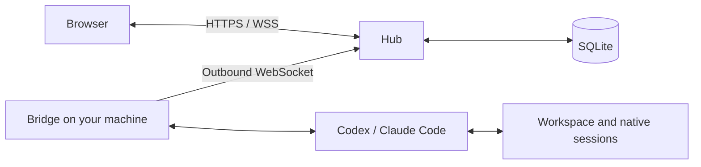

# ProofBridge

<p align="center">
  
</p>

<p align="center"><strong>Use Codex and Claude Code on your own machines, from a browser.</strong></p>

<p align="center">
  <a href="https://github.com/Atingaii/ProofBridge/actions/workflows/ci.yml?query=branch%3Amain"></a>
  <a href="https://github.com/Atingaii/ProofBridge/releases/latest"></a>
  <a href="go.mod"></a>
</p>

<p align="center">
  English · <a href="README.zh-CN.md">简体中文</a> ·
  <a href="https://test.sparkon.cn/help">User guide</a> ·
  <a href="docs/deployment.md">Self-hosting</a> ·
  <a href="https://github.com/Atingaii/ProofBridge/releases">Releases</a>
</p>

ProofBridge connects a browser to coding CLIs running in your existing workspaces.
Chat with one agent, coordinate Codex and Claude Code, and return to the same task
with its history and native context intact. A self-hosted **Hub** serves the interface on your LAN, VPN, or public network;
a **Bridge** on each private machine connects outward and runs the tools locally.

[Features](#features) · [Connect a machine](#connect-to-a-hub) ·
[Use from a terminal](#use-from-codex-or-claude-code) ·
[Self-hosting](#self-hosting) · [Local quick start](#local-quick-start) · [Architecture](#architecture-and-data-boundaries) ·
[Compatibility](#versions-and-platforms) · [Documentation](#documentation)

## Features

- **Chat and coordinate agents.** Use single-agent chat or multi-agent collaboration
  and debate, with Codex + Claude Code, Codex + Codex, or Claude Code + Claude Code.
- **Continue the same work.** Follow-ups retain the selected session or run. Unsent
  orchestration drafts are kept separately by account and task in the browser.
- **Organize task history.** Search and filter by endpoint or status, load older
  runs, rename tasks, and archive or restore finished work without losing context.
- **See what happened.** Inspect plans, tool activity, results, and token usage by
  task, model, project, or endpoint. Cost figures are API-price estimates, not bills.
- **Interact during execution.** Review tool approvals, answer native CLI questions,
  and add instructions to running tasks where the connected endpoint supports them.
- **Choose your setup.** Use local CLI login or saved provider presets, select an
  execution permission profile, and opt into formal-proof workflows with agent
  verification.
- **Use natural language from a terminal.** Copy your personal MCP configuration,
  install the ProofBridge Skill, and submit work from Codex or Claude Code. Choose
  interactive results or event-triggered email from Hub.

Availability depends on the frontend edition, Hub rollout, and Bridge/CLI
capabilities. See [versions and platforms](#versions-and-platforms) before enabling
an optional execution mode.

The enhanced leading frontend supports separate official-login Codex A/B models
and model-supported reasoning efforts, with a compatible Bridge (ConfigSwitcher
v3). Existing worker roles are retained. See the
[feature and build requirements](docs/features/official-codex-worker-models.md). Build the enhanced leading frontend with `VITE_LEADING=true VITE_OFFICIAL_CODEX_MODELS=true npm run build`.

## Connect to a Hub

Use this path if you already have a Hub account. **No repository clone or Go build
is needed on the endpoint.**

1. Install and authenticate Codex CLI and Claude Code as the OS user who will run
   Bridge. The generated setup command checks for both CLIs.
2. Sign in to your Hub. The project's current leading interface is at
   [test.sparkon.cn](https://test.sparkon.cn); use your own Hub URL when self-hosting.
3. Open **Settings → Add CLI endpoint**, optionally enter a machine name, choose
   the permission profile, and copy the generated **Install and connect** command.
4. Run that command from the project directory, as the same OS user. Select the
   online endpoint in the browser and start a conversation or task.

The setup command installs Bridge and links that directory. On Linux it prefers
`systemd --user`; otherwise it uses a background process. Logs are under
`~/.codex-bridge/logs/`. For an existing endpoint, use its **Repair connection**
command to preserve its identity.

The machine name is optional. Leave it blank to use the hostname, workspace
directory name, and path hash suffix; manual `link` commands can use `--name`.

<details>
<summary>Manual foreground connection for an already installed Bridge</summary>

Generate a token in the target Hub's settings, enter the workspace directory, and
run the following with that token. This example requests browser approval for
Codex tool execution:

```bash
~/.local/bin/codex-bridge connect \
  --hub https://test.sparkon.cn \
  --cwd "$PWD" \
  --runner codex-app-server \
  --sandbox workspace-write \
  --approval-policy untrusted \
  '<TOKEN>'
```

Replace the URL for your deployment. Always supply `--hub` for a manual connection;
do not rely on the CLI's default host. Keep the terminal open while using this
foreground mode. See [installation and service behavior](docs/dev-workflow.md#cli-install-flow).

</details>

## Use from Codex or Claude Code

First [connect your execution machine](#connect-to-a-hub). Register if your Hub
allows registration, or sign in with an account provided by its administrator.
Then open **Settings → Terminal & email**:

1. Select Codex or Claude Code. The panel shows the complete MCP configuration,
   including your Hub address and personal Token.
2. Copy the connection prompt into your trusted local AI client. It contains the
   configuration, matching Skill installer and read-only connection checks. You
   can also copy the configuration separately. The installer preserves CLI login
   and model settings. Both download stages use the official GitHub repository at
   a fixed Skill release. Restart the client if it cannot discover the Skill.
3. Save an email address and notification preferences. To leave a task running,
   enable both completion and attention email and select **Submit and email me**.
   The Hub administrator must configure SMTP first. Interactive monitoring works
   without SMTP.
4. Use the name ProofBridge, Codex Bridge or CodexBridge. Ask, for example: “Use ProofBridge on my default endpoint. Read the README and
   complete the project verification with my saved model combination. Email me
   when it finishes.” The Skill discovers available endpoints, configurations and
   defaults. Ask it explicitly to save a combination or default for future tasks.

Accepted work continues when the submitting terminal closes. Keep the execution
machine and its Bridge connected. For a lab-only Hub, clients and Bridges outside
the lab need VPN access; machines already on that network connect directly. Hub
does not need an inbound connection to your execution machine.

Skill installation requires GitHub access. MCP uses the configured Hub endpoint: loopback works on the server or through a local
tunnel; direct HTTPS connections require client trust for the server certificate.
See [GitHub Skill distribution](docs/features/github-skill-distribution.md).

Follow-ups retain the same run. Native questions and approvals still need your
answer; attention email links back to the task. A finished run is not itself proof
that verification passed, and SMTP acceptance does not guarantee inbox delivery.
Explicit model and reasoning choices depend on the selected endpoint's reported
capabilities; an MCP connection does not add credentials or model access.

Completion email contains a short result card, Token usage, estimated cost and a
details link rather than the full conversation. Metrics freeze the run's cumulative
usage at submission completion; missing or incomplete figures are labeled. See the
[email summary contract](docs/features/completion-email-summary.md).

Regenerating or revoking the personal Token invalidates old MCP configurations;
it does not cancel running tasks. Use the complete newly generated template after
rotation. For setup details, installation scopes and troubleshooting, see
[MCP and Skill access](docs/dev-workflow.md#mcp-and-skill-access). Administrators
configure `AUTOMATION_ENABLED`, `AUTOMATION_PUBLIC_URL`, `AUTOMATION_MCP_URL` and SMTP using the
[environment-variable reference](docs/dev-workflow.md#environment-variables).

SMTP setup can use the explicit `CODEX_BRIDGE_ENV_FILE` and the provider/local
templates in `configs/mail*.env.example`; the personal center can send a fixed
test to your saved address. The local template explicitly selects preview mode:
mail stays in the test inbox and never reaches an external mailbox. Real delivery
requires your own SMTP provider configuration. See [mail setup](docs/dev-workflow.md#smtp-setup-and-a-personal-delivery-test).

## Local quick start

**Requirements:** Go **1.25.7+**, Node.js **22+** with npm, Git, and Make. The
initial `echo` runner verifies the connection without calling a model.

```bash
git clone https://github.com/Atingaii/ProofBridge.git
cd ProofBridge
make build-all

cp configs/dev.yaml.example configs/dev.yaml
chmod 600 configs/dev.yaml
```

Edit `configs/dev.yaml`: set `auth.jwt_secret` to a new random secret of at least
32 bytes and `auth.bootstrap_password` to a strong password. Keep the initial
`127.0.0.1:8088` listen address and `bridge.runner: echo`.

Create the login account and an enrollment token using that configuration:

```bash
./bin/codex-bridge user
./bin/codex-bridge enroll
```

Copy the printed token into `bridge.token` in `configs/dev.yaml`. Start each
process in a separate terminal from the repository root:

```bash
# Terminal 1
./bin/codex-bridge hub
```

```bash
# Terminal 2
./bin/codex-bridge bridge
```

Open <http://127.0.0.1:8088>, sign in as `admin` with the password you set, and send
a message to the echo endpoint. To use real agents, install and authenticate the
CLIs, then follow the [Settings-based connection flow](#connect-to-a-hub).

`make build-all` embeds the standard frontend in `bin/codex-bridge`. To build the
leading dynamic-execution interface, follow the
[frontend edition instructions](docs/deployment.md#leading-and-experimental-websites).

## Self-hosting

Deploy from `main`; it includes personal MCP access, the fixed GitHub Skill installer,
SMTP notifications, native CLI questions, and dynamic orchestration. Build capabilities
still depend on the connected Bridge/CLI and account rollout settings.

```bash
git clone --branch main https://github.com/Atingaii/ProofBridge.git
cd ProofBridge
npm --prefix frontend ci
make frontend-8088      # dynamic orchestration and official Codex model selectors
make build             # embeds the UI in bin/codex-bridge
```

For a lab server, follow the [command-line installation guide](docs/deployment-8088.md)
for private configuration, account creation, Caddy, systemd, endpoint connection,
verification, and upgrades. It uses these separate settings:

```ini
AUTOMATION_PUBLIC_URL=http://10.0.0.10:8088
AUTOMATION_MCP_URL=http://127.0.0.1:8088
HUB_COOKIE_SECURE=false
```

Replace the example IP with your server address. The first URL is used for browser
and task links; the second is copied into personal MCP settings with `/mcp` appended.
Skill downloads remain on GitHub at a fixed version.

| Where the CLI runs | Connection |
| --- | --- |
| On the lab server, including an SSH terminal | Use the server's loopback MCP URL directly |
| On your laptop outside the lab | Connect VPN, then forward a local port over SSH; VPN alone does not redirect `127.0.0.1` |
| Anywhere with direct HTTPS access | Use a reachable HTTPS MCP base, or leave the override empty to inherit the HTTPS public URL |

For the laptop route, keep this command running locally before opening the MCP client:

```bash
ssh -N -o ExitOnForwardFailure=yes -o ServerAliveInterval=30 \
  -L 127.0.0.1:8088:127.0.0.1:8088 user@10.0.0.10
```

Use [HTTPS deployment](docs/deployment.md#option-e--production-systemd--caddy) for
public access. [Docker](docs/deployment.md#option-d--docker), a
[portable package](docs/deployment.md#option-c--portable-package), and the
[environment reference](docs/dev-workflow.md#environment-variables) are also available.
Preserve SQLite, the JWT secret, private configuration, and Bridge identities on upgrades.

## Architecture and data boundaries



- **Hub:** serves the embedded UI and authenticated API; persists users, messages,
  task history, events, and usage in SQLite. Administrators can inspect user
  analytics and conversation content through the documented read-only admin UI.
- **Bridge:** runs CLI processes and accesses the workspace on the private machine.
  Native CLI login state and native session files remain on that machine.
- **Provider presets:** optional API keys saved through the model library are
  received by Hub, encrypted at rest in its vault, and wrapped for a selected
  Bridge when needed. This is not end-to-end encryption against the Hub operator.
- **Permissions:** browser approvals and optional Linux workspace isolation control
  tool execution. Choose a profile that matches the trust you place in a task.

See the [architecture](docs/architecture.md),
[provider credential model](docs/features/user-scoped-cli-provider-presets.md), and
[permission profiles](docs/features/cli-permission-profiles.md) for the full boundaries.

## Versions and platforms

This README describes the current repository. **Source code, deployed websites,
GitHub release assets, and running Bridges can have different versions.** Check
[release notes and available assets](https://github.com/Atingaii/ProofBridge/releases)
when installing a published package; it may predate capabilities documented here.

| Surface | Current scope |
| --- | --- |
| `main` source | Current integrated Hub, Bridge, MCP/Skill and notification implementation |
| Dynamic frontend | `make frontend-8088`, then `make build`; native features depend on the connected endpoint |
| Linux amd64 / arm64 | Bridge installer and build targets; WSL2 uses the Linux path |
| macOS Intel / Apple Silicon | Native installer and build targets; background process needs restarting after reboot. Native installation/connection validation is still pending in the [Mac validation record](docs/features/macos-installation.md#validation-record). |
| Android | Lightweight system-WebView client; [release setup](docs/dev-workflow.md#android-release) uses `JAVA_HOME`, `ANDROID_HOME`, `ANDROID_SIGNING_PROPERTIES`; APKs published separately |

Manual Android CI uses private `ANDROID_RELEASE_KEYSTORE_BASE64`, `ANDROID_RELEASE_STORE_PASSWORD`, `ANDROID_RELEASE_KEY_ALIAS`, and `ANDROID_RELEASE_KEY_PASSWORD` secrets; see the release setup above.

Android 7.0+ online client: [download signed APK](https://codex.sparkon.cn/android/codex-bridge-1.1.0.apk) (18,408 bytes), [SHA256](https://codex.sparkon.cn/android/codex-bridge-1.1.0.apk.sha256). Installed footprint and host plus WebView renderer memory still require device measurement.

Website deployment does **not** upgrade or restart connected Bridges. Native
questions and runtime instructions require compatible Hub, frontend, Bridge,
CLI, and rollout settings. Consult [native questions](docs/features/native-structured-user-input.md)
and [dynamic input](docs/features/dynamic-orchestration-input.md) for the current
capability gates; CLI minimum versions alone do not prove every later version
has been tested.

Strict workspace isolation requires Linux with Landlock ABI 3 or newer.
Project-specific Rocq/Coq, Lean, or Isabelle toolchains must be available on the
connected machine. See [strict workspace mode](docs/features/strict-workspace-auto-execute.md)
and [Agent verification](docs/adr/030-agent-only-verification.md).

## Documentation

| Looking for | Read |
| --- | --- |
| Illustrated product walkthrough | [Online help](https://test.sparkon.cn/help) |
| Deployment and troubleshooting | [Deployment guide](docs/deployment.md) |
| Local configuration and development | [Development workflow](docs/dev-workflow.md) |
| Architecture and source layout | [Architecture](docs/architecture.md) · [Code map](docs/code-map.md) |
| Session continuity and local resume | [Continuity](docs/features/orchestration-continuity.md) · [ACP runner](docs/features/acp-runner.md) |
| Drafts, history, and request recovery | [Desktop reliability](docs/features/desktop-audit-fixes.md) |
| Token accounting and administrator access | [Usage overview](docs/features/orchestration-usage-overview.md) · [Admin dashboard](docs/features/admin-usage-dashboard.md) |
| Project status and design decisions | [Roadmap](docs/plan.md) · [Features](docs/features/) · [ADRs](docs/adr/) |

## Development and contributing

Use [GitHub Issues](https://github.com/Atingaii/ProofBridge/issues) for reproducible
bugs and focused proposals. Include the affected UI/Hub/Bridge versions, OS,
steps, and sanitized logs; omit tokens, keys, and private task content.

Read [AGENTS.md](AGENTS.md) and the [change-impact guide](docs/change-impact.md)
before a substantial change. Update the relevant feature design or ADR, preserve
conversation continuity, and run the checks appropriate to your changes:

```bash
make test
npm --prefix frontend test
make doc-lint
```

After frontend changes, run `make build-all` to refresh the checked-in embedded
assets and rebuild the binary. Trellis is optional development tooling; setup is
documented in the [development workflow](docs/dev-workflow.md#trellis-for-codex).
Follow the repository's [commit message contract](AGENTS.md#r6-commit-message-contract).

## License

This repository does not currently include a project `LICENSE` file.
Third-party components retain their own licenses.
