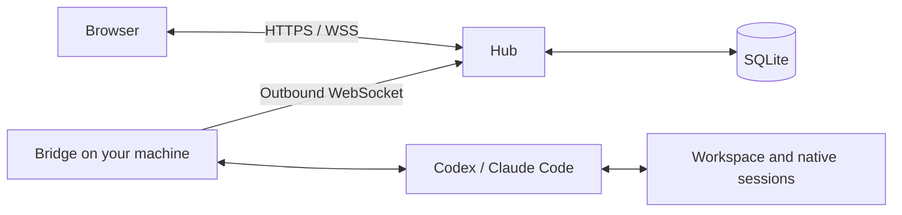

# ProofBridge

<p align="center">
  
</p>

<p align="center"><strong>Use Codex and Claude Code on your own machines, from a browser.</strong></p>

<p align="center">
  <a href="https://github.com/Atingaii/ProofBridge/actions/workflows/ci.yml?query=branch%3Amain"></a>
  <a href="https://github.com/Atingaii/ProofBridge/releases/latest"></a>
  <a href="go.mod"></a>
</p>

<p align="center">
  English · <a href="README.zh-CN.md">简体中文</a> ·
  <a href="https://test.sparkon.cn/help">User guide</a> ·
  <a href="docs/deployment.md">Self-hosting</a> ·
  <a href="https://github.com/Atingaii/ProofBridge/releases">Releases</a>
</p>

ProofBridge connects a browser to coding CLIs running in your existing workspaces.
Chat with one agent, coordinate Codex and Claude Code, and return to the same task
with its history and native context intact. A public **Hub** serves the interface;
a **Bridge** on each private machine connects outward and runs the tools locally.

[Features](#features) · [Connect a machine](#connect-to-a-hub) ·
[Local quick start](#local-quick-start) · [Architecture](#architecture-and-data-boundaries) ·
[Compatibility](#versions-and-platforms) · [Documentation](#documentation)

## Features

- **Chat and coordinate agents.** Use single-agent chat or multi-agent collaboration
  and debate, with Codex + Claude Code, Codex + Codex, or Claude Code + Claude Code.
- **Continue the same work.** Follow-ups retain the selected session or run. Unsent
  orchestration drafts are kept separately by account and task in the browser.
- **Organize task history.** Search and filter by endpoint or status, load older
  runs, rename tasks, and archive or restore finished work without losing context.
- **See what happened.** Inspect plans, tool activity, results, and token usage by
  task, model, project, or endpoint. Cost figures are API-price estimates, not bills.
- **Interact during execution.** Review tool approvals, answer native CLI questions,
  and add instructions to running tasks where the connected endpoint supports them.
- **Choose your setup.** Use local CLI login or saved provider presets, select an
  execution permission profile, and opt into formal-proof workflows with agent
  verification or TBCI.

Availability depends on the frontend edition, Hub rollout, and Bridge/CLI
capabilities. See [versions and platforms](#versions-and-platforms) before enabling
an optional execution mode.

The enhanced leading frontend supports separate official-login Codex A/B models
and model-supported reasoning efforts, with a compatible Bridge (ConfigSwitcher
v3). Existing worker roles are retained. See the
[feature and build requirements](docs/features/official-codex-worker-models.md). Build the enhanced leading frontend with `VITE_LEADING=true VITE_OFFICIAL_CODEX_MODELS=true npm run build`.

## Connect to a Hub

Use this path if you already have a Hub account. **No repository clone or Go build
is needed on the endpoint.**

1. Install and authenticate Codex CLI and Claude Code as the OS user who will run
   Bridge. The generated setup command checks for both CLIs.
2. Sign in to your Hub. The project's current leading interface is at
   [test.sparkon.cn](https://test.sparkon.cn); use your own Hub URL when self-hosting.
3. Open **Settings → Add CLI endpoint**, choose the permission profile, and copy
   the generated **Install and connect** command.
4. Run that command from the project directory, as the same OS user. Select the
   online endpoint in the browser and start a conversation or task.

The setup command installs Bridge and links that directory. On Linux it prefers
`systemd --user`; otherwise it uses a background process. Logs are under
`~/.codex-bridge/logs/`. For an existing endpoint, use its **Repair connection**
command to preserve its identity.

<details>
<summary>Manual foreground connection for an already installed Bridge</summary>

Generate a token in the target Hub's settings, enter the workspace directory, and
run the following with that token. This example requests browser approval for
Codex tool execution:

```bash
~/.local/bin/codex-bridge connect \
  --hub https://test.sparkon.cn \
  --cwd "$PWD" \
  --runner codex-app-server \
  --sandbox workspace-write \
  --approval-policy untrusted \
  '<TOKEN>'
```

Replace the URL for your deployment. Always supply `--hub` for a manual connection;
do not rely on the CLI's default host. Keep the terminal open while using this
foreground mode. See [installation and service behavior](docs/dev-workflow.md#cli-install-flow).

</details>

## Local quick start

**Requirements:** Go **1.25.7+**, Node.js **22+** with npm, Git, and Make. The
initial `echo` runner verifies the connection without calling a model.

```bash
git clone https://github.com/Atingaii/ProofBridge.git
cd ProofBridge
make build-all

cp configs/dev.yaml.example configs/dev.yaml
chmod 600 configs/dev.yaml
```

Edit `configs/dev.yaml`: set `auth.jwt_secret` to a new random secret of at least
32 bytes and `auth.bootstrap_password` to a strong password. Keep the initial
`127.0.0.1:8088` listen address and `bridge.runner: echo`.

Create the login account and an enrollment token using that configuration:

```bash
./bin/codex-bridge user
./bin/codex-bridge enroll
```

Copy the printed token into `bridge.token` in `configs/dev.yaml`. Start each
process in a separate terminal from the repository root:

```bash
# Terminal 1
./bin/codex-bridge hub
```

```bash
# Terminal 2
./bin/codex-bridge bridge
```

Open <http://127.0.0.1:8088>, sign in as `admin` with the password you set, and send
a message to the echo endpoint. To use real agents, install and authenticate the
CLIs, then follow the [Settings-based connection flow](#connect-to-a-hub).

`make build-all` embeds the standard frontend in `bin/codex-bridge`. To build the
leading dynamic-execution interface, follow the
[frontend edition instructions](docs/deployment.md#leading-and-experimental-websites).

## Self-hosting

One binary provides both `hub` and `bridge`. A typical deployment has one public
Hub and one or more private Bridges; no inbound port is needed on those machines.

| Deployment | Guide |
| --- | --- |
| Linux server with TLS and service management | [systemd + Caddy](docs/deployment.md#option-e--production-systemd--caddy) |
| Containerized Hub | [Docker](docs/deployment.md#option-d--docker) |
| Copy, extract, and run on Linux amd64 | [Portable package](docs/deployment.md#option-c--portable-package) |
| Configuration and environment variables | [Development workflow](docs/dev-workflow.md#environment-variables) |

For an internet-facing Hub, configure HTTPS, secure cookies, private credentials,
and persistent SQLite storage. Follow the [deployment guide](docs/deployment.md)
for account creation, registration policy, backups, and verification.

## Architecture and data boundaries



- **Hub:** serves the embedded UI and authenticated API; persists users, messages,
  task history, events, and usage in SQLite. Administrators can inspect user
  analytics and conversation content through the documented read-only admin UI.
- **Bridge:** runs CLI processes and accesses the workspace on the private machine.
  Native CLI login state and native session files remain on that machine.
- **Provider presets:** optional API keys saved through the model library are
  received by Hub, encrypted at rest in its vault, and wrapped for a selected
  Bridge when needed. This is not end-to-end encryption against the Hub operator.
- **Permissions:** browser approvals and optional Linux workspace isolation control
  tool execution. Choose a profile that matches the trust you place in a task.

See the [architecture](docs/architecture.md),
[provider credential model](docs/features/user-scoped-cli-provider-presets.md), and
[permission profiles](docs/features/cli-permission-profiles.md) for the full boundaries.

## Versions and platforms

This README describes the current repository. **Source code, deployed websites,
GitHub release assets, and running Bridges can have different versions.** Check
[release notes and available assets](https://github.com/Atingaii/ProofBridge/releases)
when installing a published package; it may predate capabilities documented here.

| Surface | Current scope |
| --- | --- |
| [test.sparkon.cn](https://test.sparkon.cn) | Leading interface, including dynamic execution |
| [proofbridge.sparkon.cn](https://proofbridge.sparkon.cn) | Previous frontend; shares the Hub and server-side data with the leading site |
| Linux amd64 / arm64 | Bridge installer and build targets; WSL2 uses the Linux path |
| macOS Intel / Apple Silicon | Native installer and build targets; background process needs restarting after reboot. Native installation/connection validation is still pending in the [Mac validation record](docs/features/macos-installation.md#validation-record). |
| Android | Lightweight system-WebView client; [release setup](docs/dev-workflow.md#android-release) uses `JAVA_HOME`, `ANDROID_HOME`, `ANDROID_SIGNING_PROPERTIES`; APKs published separately |

Manual Android CI uses private `ANDROID_RELEASE_KEYSTORE_BASE64`, `ANDROID_RELEASE_STORE_PASSWORD`, `ANDROID_RELEASE_KEY_ALIAS`, and `ANDROID_RELEASE_KEY_PASSWORD` secrets; see the release setup above.

Android 7.0+ online client: [download signed APK](https://codex.sparkon.cn/android/codex-bridge-1.1.0.apk) (18,408 bytes), [SHA256](https://codex.sparkon.cn/android/codex-bridge-1.1.0.apk.sha256). Installed footprint and host plus WebView renderer memory still require device measurement.

Website deployment does **not** upgrade or restart connected Bridges. Native
questions and runtime instructions require compatible Hub, frontend, Bridge,
CLI, and rollout settings. Consult [native questions](docs/features/native-structured-user-input.md)
and [dynamic input](docs/features/dynamic-orchestration-input.md) for the current
capability gates; CLI minimum versions alone do not prove every later version
has been tested.

Strict workspace isolation requires Linux with Landlock ABI 3 or newer. Managed
TBCI is bundled only for Linux amd64; project-specific Rocq/Coq, Lean, or Isabelle
toolchains are still required. See [strict workspace mode](docs/features/strict-workspace-auto-execute.md)
and [TBCI verification](docs/features/tbci-formal-proof-verification.md).

## Documentation

| Looking for | Read |
| --- | --- |
| Illustrated product walkthrough | [Online help](https://test.sparkon.cn/help) |
| Deployment and troubleshooting | [Deployment guide](docs/deployment.md) |
| Local configuration and development | [Development workflow](docs/dev-workflow.md) |
| Architecture and source layout | [Architecture](docs/architecture.md) · [Code map](docs/code-map.md) |
| Session continuity and local resume | [Continuity](docs/features/orchestration-continuity.md) · [ACP runner](docs/features/acp-runner.md) |
| Drafts, history, and request recovery | [Desktop reliability](docs/features/desktop-audit-fixes.md) |
| Token accounting and administrator access | [Usage overview](docs/features/orchestration-usage-overview.md) · [Admin dashboard](docs/features/admin-usage-dashboard.md) |
| Project status and design decisions | [Roadmap](docs/plan.md) · [Features](docs/features/) · [ADRs](docs/adr/) |

## Development and contributing

Use [GitHub Issues](https://github.com/Atingaii/ProofBridge/issues) for reproducible
bugs and focused proposals. Include the affected UI/Hub/Bridge versions, OS,
steps, and sanitized logs; omit tokens, keys, and private task content.

Read [AGENTS.md](AGENTS.md) and the [change-impact guide](docs/change-impact.md)
before a substantial change. Update the relevant feature design or ADR, preserve
conversation continuity, and run the checks appropriate to your changes:

```bash
make test
npm --prefix frontend test
make doc-lint
```

After frontend changes, run `make build-all` to refresh the checked-in embedded
assets and rebuild the binary. Trellis is optional development tooling; setup is
documented in the [development workflow](docs/dev-workflow.md#trellis-for-codex).
Follow the repository's [commit message contract](AGENTS.md#r6-commit-message-contract).

## License

This repository does not currently include a project `LICENSE` file.
Third-party components retain their own licenses.
