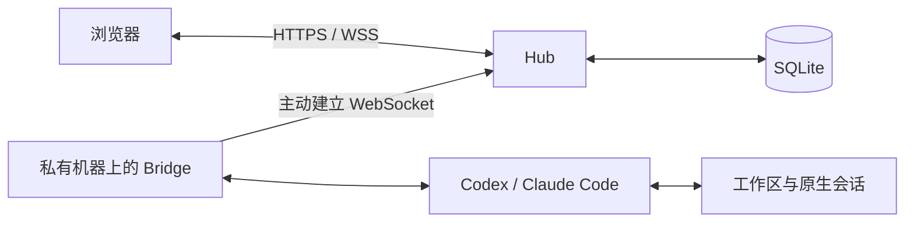

# ProofBridge

<p align="center">
  
</p>

<p align="center"><strong>从浏览器使用自己机器上的 Codex 与 Claude Code。</strong></p>

<p align="center">
  <a href="https://github.com/Atingaii/ProofBridge/actions/workflows/ci.yml?query=branch%3Amain"></a>
  <a href="https://github.com/Atingaii/ProofBridge/releases/latest"></a>
  <a href="go.mod"></a>
</p>

<p align="center">
  <a href="README.md">English</a> · 简体中文 ·
  <a href="https://test.sparkon.cn/help">使用教程</a> ·
  <a href="docs/deployment.md">自建部署</a> ·
  <a href="https://github.com/Atingaii/ProofBridge/releases">发行版本</a>
</p>

ProofBridge 将浏览器连接到已有工作区中的编程 CLI。你可以与单个智能体对话、组织
Codex 和 Claude Code 协作，并带着历史记录与原生上下文继续同一个任务。
公网 **Hub** 提供操作界面；私有机器上的 **Bridge** 主动向外连接，在本机执行工具。

[核心功能](#核心功能) · [接入机器](#连接现有-hub) ·
[本地启动](#本地快速启动) · [架构](#架构与数据边界) ·
[兼容性](#版本与平台) · [文档](#文档导航)

## 核心功能

- **对话与多智能体协作。** 支持单 CLI 对话，以及 Codex + Claude Code、
  Codex + Codex、Claude Code + Claude Code 的协作与辩论。
- **延续当前工作。** 继续输入沿用选中的会话或运行；未发送的编排草稿按账户和任务
  分别保存在浏览器中。
- **整理任务历史。** 按端点、状态筛选和搜索，加载更早记录、重命名任务，归档或恢复
  已结束的运行，保留原有上下文。
- **查看执行过程。** 检查计划、工具活动、结果，按任务、模型、项目或端点查看
  Token 用量；费用显示为 API 标价估算，不是实际账单。
- **运行中交互。** 在浏览器中处理工具审批、回答 CLI 原生问题，并在端点支持时向
  正在运行的任务追加指令。
- **选择适合的配置。** 使用 CLI 本地登录或已保存的服务商配置，选择执行权限策略，
  并按需启用由 Agent 或 TBCI 验证的形式化证明流程。

功能可用性取决于前端版本、Hub 开放策略以及 Bridge/CLI 能力。启用可选执行模式前，
请查看[版本与平台说明](#版本与平台)。

增强先行版支持为官方登录的 Codex A/B 分别选择模型及该模型支持的思考强度，
需要兼容的 Bridge（ConfigSwitcher v3），现有工作器分工保持不变。
详见[功能与构建要求](docs/features/official-codex-worker-models.md)。构建命令为 `VITE_LEADING=true VITE_OFFICIAL_CODEX_MODELS=true npm run build`。

## 连接现有 Hub

已有 Hub 账号时，使用这条路径。**接入机器无需克隆仓库，也无需安装 Go 或自行编译。**

1. 用运行 Bridge 的系统用户安装并认证 Codex CLI 和 Claude Code。网页生成的接入
   命令会检查两个 CLI 是否可用。
2. 登录目标 Hub。项目当前的新版界面位于 [test.sparkon.cn](https://test.sparkon.cn)；
   自建部署请使用自己的 Hub 地址。
3. 打开 **设置 → 添加 CLI 端**，选择权限策略，复制页面生成的**安装并连接**命令。
4. 在项目目录中，用同一系统用户执行该命令。在浏览器中选中上线的端点，开始对话或任务。

接入命令会安装 Bridge 并绑定当前目录。在 Linux 上优先使用 `systemd --user`，
不可用时改用后台进程。日志位于 `~/.codex-bridge/logs/`。已有端点需要修复时，
使用其**修复连接**命令以保留原有身份。

<details>
<summary>已安装 Bridge 时，手动以前台模式连接</summary>

在目标 Hub 的设置页生成 token，进入工作目录后，将它填入以下命令。此示例要求
Codex 的工具执行通过浏览器审批：

```bash
~/.local/bin/codex-bridge connect \
  --hub https://test.sparkon.cn \
  --cwd "$PWD" \
  --runner codex-app-server \
  --sandbox workspace-write \
  --approval-policy untrusted \
  '<TOKEN>'
```

自建部署请替换 URL。手动连接时始终显式传入 `--hub`，不要依赖 CLI 的默认域名。
前台模式需要保持终端打开。详见[安装与服务行为](docs/dev-workflow.md#cli-install-flow)。

</details>

## 本地快速启动

**构建要求：** Go **1.25.7+**、Node.js **22+** 及 npm、Git、Make。
首次使用 `echo` runner 验证连接，无需调用模型。

```bash
git clone https://github.com/Atingaii/ProofBridge.git
cd ProofBridge
make build-all

cp configs/dev.yaml.example configs/dev.yaml
chmod 600 configs/dev.yaml
```

编辑 `configs/dev.yaml`：将 `auth.jwt_secret` 设置为至少 32 字节的新随机密钥，
将 `auth.bootstrap_password` 设置为强密码。首次保留 `127.0.0.1:8088` 监听地址和
`bridge.runner: echo`。

使用上述配置创建登录账号与接入 token：

```bash
./bin/codex-bridge user
./bin/codex-bridge enroll
```

将输出的 token 写入 `configs/dev.yaml` 的 `bridge.token`。分别打开两个终端，
在仓库根目录启动：

```bash
# Terminal 1
./bin/codex-bridge hub
```

```bash
# Terminal 2
./bin/codex-bridge bridge
```

打开 <http://127.0.0.1:8088>，使用 `admin` 和刚设置的密码登录，向 echo 端点发送
一条消息。使用真实智能体时，先安装并认证 CLI，再按[设置页接入流程](#连接现有-hub)
连接机器。

`make build-all` 将标准前端嵌入 `bin/codex-bridge`。如需构建新版动态执行界面，
请按[前端版本构建说明](docs/deployment.md#leading-and-experimental-websites)操作。

## 自建部署

同一个二进制提供 `hub` 和 `bridge` 两种运行模式。典型部署包含一个公网 Hub 和
一个或多个私有 Bridge；私有机器无需开放入站端口。

| 部署方式 | 指南 |
| --- | --- |
| 带 TLS 与服务管理的 Linux 服务器 | [systemd + Caddy](docs/deployment.md#option-e--production-systemd--caddy) |
| 容器化运行 Hub | [Docker](docs/deployment.md#option-d--docker) |
| 拷贝、解压后在 Linux amd64 上运行 | [Portable 包](docs/deployment.md#option-c--portable-package) |
| 配置项与环境变量 | [开发工作流](docs/dev-workflow.md#environment-variables) |

公网 Hub 需要配置 HTTPS、安全 Cookie、独立凭据和持久化 SQLite 存储。账号创建、
注册策略、备份与验收步骤统一见[部署指南](docs/deployment.md)。

## 架构与数据边界



- **Hub：** 提供内嵌界面与认证 API，将用户、消息、任务历史、事件和用量保存在
  SQLite。管理员可通过有明确权限边界的只读页面查看用户统计及对话内容。
- **Bridge：** 在私有机器上运行 CLI 进程并访问工作区。CLI 原生登录状态和原生
  会话文件保留在该机器上。
- **服务商配置：** 通过模型库保存的可选 API key 会由 Hub 接收，在密钥库中加密
  存储，并在需要时加密封装给选定的 Bridge。这不属于对 Hub 运营方不可见的端到端加密。
- **执行权限：** 浏览器审批和可选的 Linux 工作区隔离约束工具执行。根据任务的
  信任程度选择权限策略。

完整边界见[架构说明](docs/architecture.md)、
[服务商凭据模型](docs/features/user-scoped-cli-provider-presets.md)和
[权限策略](docs/features/cli-permission-profiles.md)。

## 版本与平台

本 README 对应当前仓库内容。**源码、已部署网站、GitHub 发行包和运行中的 Bridge
可能处于不同版本。** 安装发布包前请检查[发行说明与实际附件](https://github.com/Atingaii/ProofBridge/releases)；
它们可能早于本文描述的部分能力。

| 入口或平台 | 当前范围 |
| --- | --- |
| [test.sparkon.cn](https://test.sparkon.cn) | 新版界面，包含动态执行 |
| [proofbridge.sparkon.cn](https://proofbridge.sparkon.cn) | 保留旧版前端，与新版站点共享 Hub 和服务端数据 |
| Linux amd64 / arm64 | 提供 Bridge 安装器与构建目标；WSL2 使用 Linux 接入方式 |
| macOS Intel / Apple Silicon | 提供原生安装器与构建目标；重启机器后需重新启动后台进程。[Mac 验收记录](docs/features/macos-installation.md#validation-record)中的原生安装与连接实测仍待完成。 |
| Android | 轻量系统WebView客户端；[发行构建](docs/dev-workflow.md#android-release)使用 `JAVA_HOME`、`ANDROID_HOME`、`ANDROID_SIGNING_PROPERTIES`，APK单独交付 |

手动 Android CI 使用私有 `ANDROID_RELEASE_KEYSTORE_BASE64`、`ANDROID_RELEASE_STORE_PASSWORD`、`ANDROID_RELEASE_KEY_ALIAS`、`ANDROID_RELEASE_KEY_PASSWORD` secrets；配置方式见上面的发行构建文档。

Android 7.0+ 在线客户端：[下载签名 APK](https://codex.sparkon.cn/android/codex-bridge-1.1.0.apk)（18,408 bytes），[SHA256](https://codex.sparkon.cn/android/codex-bridge-1.1.0.apk.sha256)。安装实际占用和宿主加 WebView renderer 的运行内存仍需真机测量。

网站部署**不会**升级或重启已连接的 Bridge。原生问答与运行中追加指令需要匹配的
Hub、前端、Bridge、CLI 和功能开放策略。具体门禁见
[原生问答](docs/features/native-structured-user-input.md)和
[动态输入](docs/features/dynamic-orchestration-input.md)；满足 CLI 最低版本不代表
所有后续版本都已实测。

严格工作区隔离要求 Linux 支持 Landlock ABI 3 或以上。内嵌 TBCI 仅提供给 Linux
amd64；项目所需的 Rocq/Coq、Lean 或 Isabelle 工具链仍需单独准备。详见
[严格工作区](docs/features/strict-workspace-auto-execute.md)和
[TBCI 验证](docs/features/tbci-formal-proof-verification.md)。

## 文档导航

| 需要了解 | 文档 |
| --- | --- |
| 图文使用流程 | [在线帮助](https://test.sparkon.cn/help) |
| 部署与排错 | [部署指南](docs/deployment.md) |
| 本地配置与开发 | [开发工作流](docs/dev-workflow.md) |
| 架构与源码分布 | [架构](docs/architecture.md) · [代码地图](docs/code-map.md) |
| 会话连续性与本机恢复 | [上下文连续性](docs/features/orchestration-continuity.md) · [ACP runner](docs/features/acp-runner.md) |
| 草稿、历史管理与请求恢复 | [桌面可靠性](docs/features/desktop-audit-fixes.md) |
| Token 统计与管理员权限 | [用量总览](docs/features/orchestration-usage-overview.md) · [管理员面板](docs/features/admin-usage-dashboard.md) |
| 项目状态与设计决策 | [路线图](docs/plan.md) · [功能设计](docs/features/) · [ADR](docs/adr/) |

## 开发与贡献

通过 [GitHub Issues](https://github.com/Atingaii/ProofBridge/issues) 提交可复现的问题或
范围明确的建议。附上相关前端/Hub/Bridge 版本、操作系统、复现步骤及脱敏日志，
不要包含 token、密钥或私有任务内容。

较大修改前阅读 [AGENTS.md](AGENTS.md) 与[变更影响表](docs/change-impact.md)，
更新相应功能设计或 ADR，保留会话连续性，并运行与修改范围相适应的检查：

```bash
make test
npm --prefix frontend test
make doc-lint
```

修改前端后，运行 `make build-all` 更新仓库内的嵌入式静态资源并重新构建二进制。
Trellis 是可选开发工具，配置见[开发工作流](docs/dev-workflow.md#trellis-for-codex)。
提交遵循仓库的[提交信息约定](AGENTS.md#r6-commit-message-contract)。

## 许可证

仓库目前没有项目级 `LICENSE` 文件。第三方组件仍适用各自的许可证。
