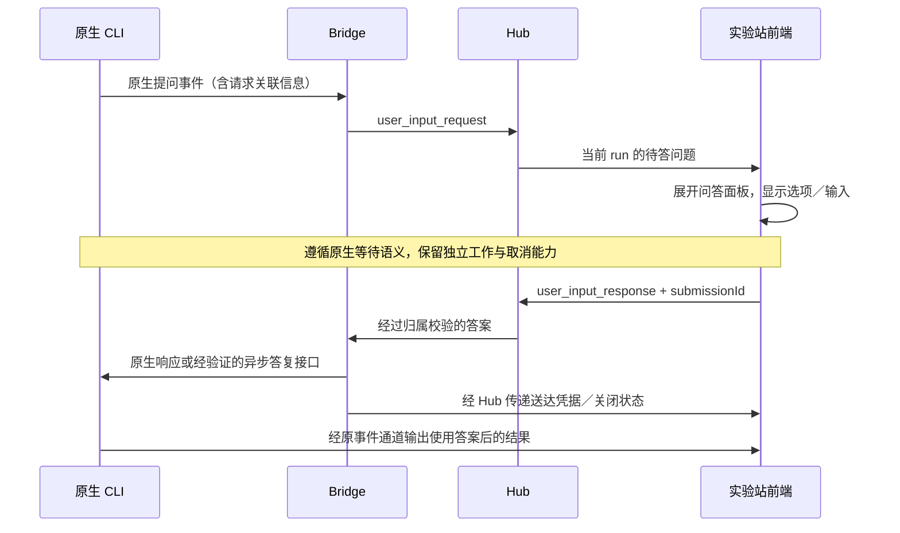

# 原生待答问题透传：运行时交互补全计划

状态：**用户已批准实施；Q0 原生契约核实和代码实现进行中，尚未完成端到端验收或部署。**

本计划承接[功能契约](native-structured-user-input.md)、[ADR 024](../adr/024-native-structured-user-input.md)和[v3 回归修复](native-structured-user-input-regression-plan.md)。原有协议、可靠性修复和历史验证保留；本次补全用户再次确认的运行时交互，并完成此前缺失的真实端到端验收。任务沿用 `.trellis/tasks/09-24-native-user-interaction`，最新授权范围为制定计划。

## Goal

实验站里的 Codex／Claude Code 在运行中发起原生结构化提问后，前端主动展示题目、原生选项和允许的自定义输入。用户作答后，答案通过原生应答通道送回对应的交互，CLI 沿原有会话继续执行。用户操作与本地 CLI 的待答问题队列等价，无需进入终端寻找问题或把答案重新写成一条任务。

用户举例为 Codex 的 `Queued follow-up inputs → 2 questions → 选项／Other`。官方 Codex 源码确认 `request_user_input_async` 会产生携带 `delivery=async`、`questions` 的 `agentMessage`，终端通过包含 `questionItemId` 的原生用户消息作答；本机 0.156.1 app-server schema 支持这些消息字段。**这不能证明上次远端运行实际调用了该工具**，仍须取得完整链路证据。

验收包含需要审批和自动执行两种权限模式。继续沿用用户已选择的原生阻塞／非阻塞语义：需要答案才能继续的原生操作等待；原生允许继续的独立工作可以继续。前端收起面板不等于回答或取消。

## Non-Goals

- 普通聊天入口扩展、任意 MCP 表单、通知推送、问答历史数据库、CLI 死亡后复活原请求、Android 维护。
- 通过解析普通输出中的问句、`PLAN_UPDATE` 或终端界面文字制造工具请求；用另一 worker 代用户作答。
- 为显示问题而强制全局 Plan 模式、改变审批策略、自动选推荐项、增加定时默认答案。
- 为回答而调用普通 prompts 端点、新建实验站 run，或让其他 worker 代答。Codex 异步工具的原生协议例外：同一 thread 的活动 turn 经 `turn/steer`、空闲时经 `turn/start` 送入带问题 ID 的答案；不能将它混同于普通任务或同步工具回调。
- 重建 v3 状态机或开展通用日志平台改造；只修经证据确认影响该交互的路径。

## Current State

### 用户反馈与证据边界

- 用户报告更新后点击**新运行**，看到了模型输出的三个普通文字问题和完成计划标记，没有可选问题界面；用户确认右侧**没有能力告警**。
- 这证明此次产品验收没有达到预期，不能证明具体是哪一层故障；没有原生事件证据时，不能断言模型没调用工具或前端丢帧。
- 先前完整 Go／前端测试、CLI 原生探针、模拟浏览器测试分别通过过；实施记录明确缺少“真实模型→当前 Hub/Bridge→实际浏览器→原生继续”的单次完整证据。
- 本地工作区与用户已更新的组件是否为同一版本尚未核实。本计划不把用户“已更新”写成已验证部署成功。

### 已有能力与要核实的缺口

| 切面 | 已有实现／证据锚点 | 本次行动 |
| --- | --- | --- |
| Codex 原生入口 | `internal/bridge/appserver_runner.go:readEvents` 接收 `item/tool/requestUserInput`，处理 `serverRequest/resolved` | 查清当前 CLI 的同步／异步工具如何映射到传输事件，以及默认模式实际工具是否开放 |
| Codex 生命周期 | 同一 `readEvents` 在退出时关闭其登记的待答请求 | 验证异步队列是否允许跨模型 turn 保持待答；当前清理行为是待验证假设，不能直接宣布为本次根因 |
| Codex 引导 | `internal/bridge/codex_user_input.go:codexUserInputPrompt` 只提及 `request_user_input` | 按真实工具清单引导；审查 durable 计划／交接指令是否冲突，不向不可用工具发指令 |
| Claude 通道 | `internal/bridge/orchestration_claude.go:prepareClaudeApprovalServer`、`internal/bridge/claude_approval_mcp.go:handleClaudeApprovalMCPToolCall` | 用真实 CLI 经当前 helper 完成前端作答；保留自动执行模式下问答回调 |
| 路由与可靠性 | `internal/bridge/user_input.go:RegisterUserInput`、`internal/hub/user_input.go:handleUserInputFromBridge`；v3 request/status/receipt/snapshot | 复用现有路由与身份绑定，核验问题到卡片、回答到 native write 的每一跳 |
| 任务图 | `internal/hub/task_graph.go:dispatchTaskAttempt` 从基础 payload 派发并保留问答字段 | 真实验证创建、计划节点、worker、继续运行；不能只绕过任务图测试 adapter |
| 页面呈现 | `frontend/src/app/pages/OrchestrationWorkspace.tsx:OrchestrationWorkspace` 有固定入口，卡片在可滚动日志前方；`frontend/src/app/components/UserInputCard.tsx:UserInputCard` 支持选项和自定义输入 | 改为问题到达时主动可见的问答面板，复用卡片内容与同一状态源 |
| 能力告警 | 上述 Workspace 的 `nativeInputWarnings` 依赖功能 rollout；功能关闭时没有该告警 | 能力可用、未启用、组件不兼容、未知分别可见；不能用没有告警代表可用 |

2026-09-29 用户要求按官方功能引入版本开放后续版本：最低版本和模式范围见[功能契约](native-structured-user-input.md#版本范围修复2026-09-29)。不再使用精确版本白名单；保留 v3、权限与原生字段校验，新版本可用不等于每个版本均已实测。

## Design

### 1. 原生通道与身份



保留 run、execution、worker、instance、原生 request ID 及问题 ID 的关联；不同 worker 的相同原生 ID 不共享答案。界面中的文本标签不作为任意目标路由地址。

阻塞请求验收同一原生 turn 等待和继续。异步请求如果原生先返回、之后通过关联消息交付答案，应使用该原生机制，验收同一会话与交互关联；不能将“所有工具都必须在同一 turn 内结束”作为未经验证的统一前提，也不能用普通聊天消息模拟异步回传。

已证实两种工具使用不同原生协议：阻塞式 `item/tool/requestUserInput` 使用原 JSON-RPC 请求／答复；异步 `agentMessage` 的工具调用立即完成，答案经包含 `questionItemId` 的原生用户消息送入同一 Codex thread。活动 turn 用 `turn/steer`，空闲 turn 用 `turn/start`；问题所有权必须跨原 turn 保留到答案交付或原生失效。工具名称、终端 UI 名称与传输方法分别记录，不以屏幕上的 `Queued follow-up inputs` 当协议。

### 2. 问题队列与前端体验

- 当前 run 出现首个新待答请求时，自动展开可见的问答面板；桌面可用侧面板，窄屏采用适配面板。复用现有 `UserInputCard`，仅有一份可编辑表单。
- 面板显示 CLI／worker、待答题数、题目、选项说明、自定义输入及“提交回答”；与命令审批区分命名。
- 多个原生请求进入队列，可切换待答项，新增请求不覆盖正在填写的草稿，也不连续抢焦点。一个请求含多题时显示明确的题目进度。
- 逐题答复还是整组提交由实际原生契约决定：支持独立答复就独立回传；只支持原子题组时可逐题填写、整组明确提交，不伪造部分成功。不同请求互不强制等待。
- 收起面板后保留固定“待你回答 N 题”入口；收起不会关闭原生请求。刷新恢复存活请求时恢复可见入口；只读的终态回执不冒充待答项。
- 键盘可操作、合理管理焦点，屏幕阅读器能获知新问题；桌面长日志和 390px 屏幕均可见。未提交选择不自动发送。
- 状态仍使用 v3 的 pending／submitting／confirming／delivered 与生命周期事实，使用已有独立 receipt；“已送达”只说明写回成功，模型后续结果用于证明它已使用答案。

### 3. 原生等待与恢复

- 请求存活时，保留原生回传通道和必要的会话资源；Bridge 继续读消息、处理心跳、普通审批、用户停止。
- 先用原生事件证据确认异步队列的寿命。若确实跨 turn 存活，把所需待答登记与读取责任放在对应 native client/session 生命周期中，避免 turn reader 退出即误关闭；不得同时启动竞争消费同一事件通道的 reader。
- 如果当前 CLI 明确规定 turn 结束即关闭，则按原生关闭显示失效，并验证正常作答窗口；若该版本无法实现用户样例，记录为能力缺口，解决原生访问路径后再验收，不能把样例从范围中删掉。
- 原生 resolved／cancel、整个 run 显式停止和进程死亡按各自边界清理。单个非阻塞问题不能拖住不相关 worker；普通空闲／卡死判定不得把真实等待用户当执行卡死。
- 保留已有有限队列、outbox、幂等提交、迟到提交封禁、unknown 不自动重放、多标签首个有效提交获胜、刷新与终态只读核对。

### 4. 可用性与最小诊断

面向用户显示明确状态：可用、未启用、当前组件不支持或尚未确认。Hub 功能关闭和 CLI 版本不匹配均有可理解的提示；查看实际运行时按该 run/worker 的配置判定，不以另一台所选机器或编辑中的配置推断。

实施时补足仅用于定位这一链路的无内容诊断：运行派发的能力状态、Bridge 启用结果、原生请求接收／拒绝、问题投递、答复写回及关闭的原因码和关联 ID。复用适当的已认证状态／事件通道；只有真实接到 native request 才显示“已发起原生提问”。不记录问题、答案、密钥或全量模型请求，不把诊断自动纳入公开分享。

能力状态和原生调用事实分开：功能可用不保证模型一定提问；模型声称已提问也不证明发生调用。固定验收任务没有实际调用时记为失败，工程师查看阶段证据并修复，不让用户反复猜提示词或到控制台排查。

### 5. 数据和兼容影响

- 默认复用 `internal/protocol/envelope.go:UserInputRequestPayload` 等 v3 消息、现有 Hub/Bridge WS 和前端 reducer；不新增数据库或普通 prompt 写端点。
- 待答队列／主动展开主要为前端状态变化；native 生命周期修复在适配器和会话所有者范围内进行。
- 诊断若需增加可选能力或 run 元数据，同步 protocol、Hub、Bridge、前端类型、公开分享过滤和测试。只增加可选只读字段时保持旧组件兼容。
- 若实测要求新的答案编码、部分应答或跨 turn 生命周期语义，先更新 ADR 024 与对应兼容协商，再实现；不得让旧 v3 误接受新含义，也不预先为尚未证实的需求升级协议。
- 普通聊天、现有执行审批及用户原有会话继续路径作为回归保护边界。

## Implementation Steps

按 Q0–Q6 串行执行，先做最小真实闭环，再补体验和回归；已有实现可以保留，不能为执行清单而重写。

| 阶段 | 具体工作与代码责任 | 完成门禁 |
| --- | --- | --- |
| Q0 原生契约与失败复现 | 记录实际使用的 CLI 可执行文件／版本、工具暴露和启动配置；检查 `internal/bridge/client.go:BridgeCapabilities`、`internal/bridge/orchestration_codex.go:runCodexInteractive`、`internal/bridge/orchestration_claude.go:prepareClaudeApprovalServer`；验证同步和异步样例及回传方式 | 得到脱敏事件顺序和当前链路第一个缺口；事实与假设分列，不能只根据截图定根因 |
| Q1 最小真实闭环 | 沿 `readEvents`／Claude helper → `RegisterUserInput` → Hub handlers → 当前 `UserInputCard` → 原生写回逐跳核对；只修实际阻断点 | 首先 Codex 默认模式＋自动执行，在实际浏览器选择后原生收到答案；随后 Claude 同样通过 |
| Q2 原生等待补全 | 按 Q0 证据处理异步请求存活、关闭与 reader 所有权；检查 NativeSession、durable 任务和正常停止；提示只引导实际存在的工具 | 同步等待、异步排队和原生继续行为正确；无假关闭、串答、重复写入及 reader 争抢 |
| Q3 问答面板与队列 | Workspace 主动展开／收起／固定入口；复用 UserInputCard 和 userInput reducer；按原生契约提交 | 无需翻日志可见可操作；多问题、多请求、自由输入、键盘及手机场景通过 |
| Q4 状态与诊断 | 明确 rollout 关闭、版本不兼容、未知和已可用；按实际 run/worker 展示；补足无敏感内容的阶段证据 | 任一能力门禁失败均可解释；能区分“未产生请求”和“产生后传输／显示失败” |
| Q5 回归与验收 | 先定向故障测试，再前端、race、全量 Go 与构建；执行下面真实验收矩阵 | 原有行为无已知回归；单次真实链路证据齐全，不能用不同测试拼成端到端通过 |
| Q6 交付与目标机器复验 | 独立审查，按 R7 同步文档；列明 Hub/embedded UI/Bridge/CLI 各自版本及是否需要更新，完成授权部署后的 smoke | 用户在目标机器新运行中看到问答、作答并继续；剩余受限组合明确列出 |

Q0 的技术未知由工程师调研，不再向用户重复确认已明确的交互目标。若原生通道确实无法提供所需异步能力，先给出版本／协议证据和可实施兼容方案；影响架构或权限才回到设计审核，不能静默退成文本提问。

## Exit Gates

### 主验收场景

固定合成任务要求原生工具询问两题：一题选择输出语言，一题选择结果形式且允许自定义。工具发出前不给它答案。浏览器选择第一题，第二题输入仅浏览器知道的随机测试短语；原生后续结果必须使用这两个答案。合成短语可用于验收证据，真实用户答案仍不进入诊断日志。

完整记录同一条链路：原生请求 → Bridge 接收 → Hub 路由 → 实际 DOM 显示 → 用户提交 → 原生响应写入／异步交付 → 模型使用答案继续。记录版本、权限模式、工具名、事件方法和关联身份；不用模型“已发起问题”文字作为事件证据。

| 场景 | 必须看到的行为 |
| --- | --- |
| Codex 默认模式 × 自动执行／需要审批 | 可选题和自定义回答；两种权限模式均能完整回传 |
| Codex 排队式异步提问 | 对应用户样例，待答队列可见；答复走经验证的原生异步接口；原生可继续的工作不被全局暂停 |
| Codex 原生阻塞提问 | 原调用保持等待，回答后同 turn 继续；Plan 只作附加覆盖，不能替代默认模式验收 |
| Claude × 自动执行／需要审批 | 真正 AskUserQuestion；单选、自定义、原生多选无损回传；普通工具审批仍符合原权限模式 |
| 产品默认新运行路径 | 包含实际启用的计划节点／durable worker；提问发生在执行过程中，提交后不新增 run、任务、worker 来充当回答 |
| 原 run 的继续运行 | 仍经原 prompts 路径启动后续工作，其内部问答独立回传；不能仅通过新运行案例宣告全部完成 |
| 多请求／多 worker／多题 | 身份与题目不串，正在填写的草稿不被后来的问题替换；部分／整组提交遵循原生契约 |
| 长日志、收起、键盘、390px | 新问题主动可见，收起后有待答入口，无重复可编辑卡片；焦点可达且不中断另一题的输入 |
| 刷新、断线、取消、迟答 | 恢复有效请求／回执；重复提交不重复写，失效不可回答，unknown 不自动重发 |
| 能力关闭／旧组件／不支持版本 | 显示具体原因，普通运行仍符合原有行为，不生成不可见的待答等待 |

真实浏览器测试与模拟测试分别标记。测试 harness 可以确定性注入原生协议事件来覆盖故障，但不能拿它代替上表中的真实 CLI／模型验收。远端访问条件不足时明确保留目标机器门禁，不声称已验证那台机器，也不回退为让用户自行检查控制台。

### 原功能回归与执行命令

沿用[v3 计划的原功能矩阵](native-structured-user-input-regression-plan.md)：普通聊天发送／取消／resume、审批允许／拒绝、免审批、编排连续性／停止／终态、使用统计、模型目录测试隔离、公开分享和敏感字段。新失败先定位，不能通过放宽断言或反复定向重跑覆盖全量失败。

实施验证命令示例（每项单独、串行执行）：

```bash
GOMAXPROCS=2 /usr/local/go/bin/go test -p 1 ./internal/bridge ./internal/hub ./internal/protocol -run 'UserInput|AskUserQuestion' -count=1
GOMAXPROCS=2 /usr/local/go/bin/go test -p 1 -race ./internal/bridge ./internal/hub -run 'UserInput|AskUserQuestion' -count=1
npm --prefix frontend test
npm --prefix frontend run test:user-input-browser
npm --prefix frontend run build
GOMAXPROCS=2 /usr/local/go/bin/go test -p 1 ./... -count=1
make doc-lint
```

浏览器脚本的本地服务、认证和 fixture 启动方式以脚本要求为准；真实端到端另走真实原生进程，不能将 mock 脚本的成功改名为 live 成功。Go 构建按项目命令输出到任务专用临时目录；检查源码及 embedded UI 配套，完成后仅清除本次临时二进制。

## Load, Delivery And Rollback

- 持续遵循用户要求控制机器负载。开始前查看负载、可用内存及已有进程；一次只启动一个测试、构建、浏览器或 CLI 探针。Go 使用 `GOMAXPROCS=2`、`-p 1`，浏览器一个 worker，不并行跑 race、前端构建和真实模型测试。
- 可用内存低于 1 GiB、出现持续换页或服务响应恶化时，不启动新的重任务；先记录和降低本次验证并发，不停止用户服务。
- 先串行完成两种 CLI 的最小闭环，再扩大矩阵。真实模型每个案例一次进程、有限超时，失败先分类，禁止无限重试和同时启动两种 CLI 压测。
- 用户已批准实施；每项重型验证仍须独立、串行运行并记录结果。
- 当前工作区含大量先前未提交修改，实施前以实际工作区为基线；不全仓 reset/clean，不自动提交或发布。
- 交付需区分 Hub、嵌入式页面、Bridge 与 CLI 版本。部署前处理活跃交互；回滚到配套组件或关闭新入口时，显式结束失效请求、不代答、不自动恢复到另一进程。只回滚本轮变更。
- 清理逐项确认本任务创建的进程、schema／探针目录、浏览器临时配置和构建二进制。保留用户数据、凭据、既有缓存、可复用依赖及正式 embedded UI。

## Reviewer Q&A

**为什么还要规划，已有问答代码不是完成了吗？** 已有状态机和单项测试可以复用，但用户实测没有出现所需交互，完整真实链路也未验收。本计划以真实闭环为首要门禁。

**是否只是加一段提示词？** 否。提示只引导模型使用可用工具；必须识别真实原生请求、显示界面并回传答案。普通文本或计划完成标记不算调用证据。

**为什么特别列出异步队列？** 用户实例来自异步提问。原生工具名、答复编码、排队和跨 turn 生存期必须核实，不能用阻塞工具的测试外推。

**是否暂停全部 worker？** 保持已选定的原生语义。相关原生操作需要答案时等待，其他被原生允许的工作继续；用户界面始终保留作答入口。

**如何证明答案真的回去了？** 同一次真实浏览器测试中，核对原生交互身份和应答事实，并观察模型使用浏览器临时给出的测试短语继续；写入成功和模型使用分别取证。

**会不会影响原本功能？** 不作绝对零回归承诺；复用既有边界、按证据最小修复，并以上述原功能矩阵作为交付条件。

**还需要用户决定什么？** 当前没有待定产品选择。Q0 已从 Codex 0.156.1 源码和本机 schema 确认异步契约；用户目标机器的实际 CLI、模型工具暴露与完整浏览器链路仍待验收。本轮已获实施授权。
